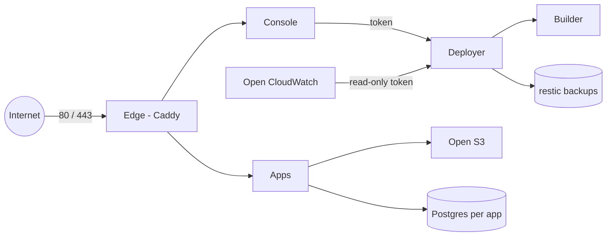

# Open Cloud

A self-hosted console for one Linux server. It builds apps from public Git repositories, gives them HTTPS, Postgres, object storage, secrets, monitoring, and encrypted backups. Docker Compose and Caddy. No Kubernetes. Only ports 80 and 443 are exposed.

*Independent project; not affiliated with or endorsed by Amazon Web Services. AWS service names are used only for comparison.*

## Features

| You know it as (AWS / GCP) | Open Cloud |
|---|---|
| Management Console | **Console**: one admin login (scrypt, sessions, CSRF, rate limits, optional [two-step login](docs/LOGIN.md)) |
| App Runner / Cloud Run | **App Runner**: a public Git URL, or an allowlisted server folder, with a Dockerfile. Build, run, roll back, per-app CPU and memory, optional health check and read-only root. New apps are **Internal** |
| CodeBuild / Cloud Build | **Deployer**: background build and rollback jobs in a rootless BuildKit sandbox |
| Elastic Load Balancing + ACM | **Open ELB**: Caddy routes, automatic HTTPS, custom domains, HTTP to HTTPS, health checks, canary |
| RDS / Cloud SQL | **Managed Postgres**: one private Postgres 17 per app. The app connects as `app_runtime`. `DATABASE_URL` is a secret file |
| Secrets Manager | **Secrets**: write-only, mounted at `/run/secrets/NAME` |
| S3 / Cloud Storage | **Open S3**: SeaweedFS S3 API, one key per app, presigned URLs |
| S3 static website | **Static sites**: upload HTML or a zip, custom domains, Let's Encrypt or a preview certificate |
| EBS / Persistent Disk | **Storage**: persistent `/data` per app |
| CloudTrail | **Audit log**: append-only hash chain (not tamper-proof against root) |
| CloudWatch + EventBridge | **Open CloudWatch**: CPU, memory, restarts, disk, backups, searchable logs with secrets redacted, alarms with email, an app event feed |
| AWS Backup | **Backups**: encrypted restic snapshots and Postgres dumps. Kept 7 days by default. You schedule them |
| Bedrock / Vertex AI | **Open Bedrock**: one provider key for apps you opt in. Optional generic gateway (off unless `OC_GENERIC_GATEWAY=1`) |
| Route 53 | **DNS page**: each domain from DNS lookup to route, certificate, and redacted edge config. It never changes DNS records |

## Architecture



The **deployer** (`oc-agent`) is the program that builds an app, starts it, stops it, and rolls it back. It is the only container that can talk to Docker. Builds run in a separate rootless sandbox (the builder) that cannot reach the deployer's API. Everything else is described in [docs/ARCHITECTURE.md](docs/ARCHITECTURE.md).

## Quick start

Install Docker Engine and Compose v2 first, and point DNS at the server (`console.example.com` and `*.apps.example.com` in the example below). Then:

```bash
git clone <repository-url> open-cloud && cd open-cloud
./install.sh
```

Edit `.env` (`OC_CONSOLE_HOST`, `OC_APPS_DOMAIN`, `OC_S3_HOST`, `OC_ACME_EMAIL`). Then:

```bash
sudo ./install.sh
```

Open `https://console.example.com` and sign in with the password the installer prints once. The full sequence, including the firewall and a local try-out with no public domain, is [docs/INSTALL.md](docs/INSTALL.md).

## Requirements

- A Linux machine with a public IP, or a LAN machine for local certificates. Tested idea: Debian 13 or Ubuntu 24.04, Docker Engine 26 or newer, Compose v2.
- Python 3 and `sudo`. Ports 80 and 443 free.
- 2 GB RAM minimum. 4 GB or more is more comfortable, because builds use up to `OC_BUILD_MEMORY` (default 2 GB).
- A domain you control, if you want publicly trusted HTTPS.
- Ubuntu 23.10 and 24.04 restrict unprivileged user namespaces. `install.sh` loads `deploy/apparmor/opencloud-builder` so the builder can start, and leaves the system-wide restriction on. See [docs/SECURITY.md](docs/SECURITY.md#build-sandbox).

## Security model

- Only the edge publishes ports, and only 80 and 443.
- The console has no Docker socket. The deployer is the only container that has one, and it only runs a fixed list of actions.
- Secrets are files, mode 0400, owned by the one container user that reads them. App settings arrive as `/run/secrets/NAME`, not as environment variables (except `PORT`).
- The installer password must be replaced at the first sign-in. Two-step login is optional and set up in the console.
- The build sandbox is hardened, not a separate machine. Deploy repositories you trust.

Detail and tradeoffs: [docs/SECURITY.md](docs/SECURITY.md). Report a vulnerability as described in [SECURITY.md](SECURITY.md).

## Status and limitations

- Backups are not scheduled. The repository stays on the same disk until you copy it off. A clean-machine rebuild is documented and not yet tested end to end. Object storage is copied while it is running. The CloudWatch database is not in the snapshot.
- Email is the only alarm channel, and it needs SMTP settings. Nothing outside this machine can tell you the machine is down.
- Apps share one network. Internal means no public address, not isolation from other apps.
- One admin account. No per-route rate limit in stock Caddy. Git sources must be public HTTPS (private code uses an allowlisted server folder). No DNS provider APIs. The audit log is not tamper-proof against root.
- Open Bedrock's provider path is tested against a local mock. Publicly trusted certificates are not covered by the automated tests.

## Documentation

| Guide | |
|---|---|
| [Install](docs/INSTALL.md) | Fresh server, DNS, `.env`, installer |
| [First login and two-step login](docs/LOGIN.md) | Password change, authenticator, recovery codes |
| [DNS and domains](docs/DNS.md) | Wildcard apps domain, the DNS page |
| [Deploy an app](docs/DEPLOY.md) | App Runner, Internal and External |
| [Prepare your app](docs/APP-GUIDE.md) | Dockerfile, `opencloud.json`, secret files, health checks |
| [Databases](docs/DATABASES.md) | Managed Postgres |
| [Storage and static sites](docs/STORAGE.md) | Open S3 and static hosting |
| [AI gateway](docs/OPEN-BEDROCK.md) | Provider key and the optional gateway |
| [Load balancer](docs/OPEN-ELB.md) | Routes, certificates, canary |
| [Backups and restore](docs/RESTORE.md) | restic, dumps, rebuild |
| [Security hardening](docs/SECURITY.md) | Boundaries and the build sandbox |
| [Troubleshooting](docs/TROUBLESHOOTING.md) | Installer, certificates, 502s, login |
| [Upgrading](docs/UPGRADING.md) | Re-run the installer |
| [Architecture](docs/ARCHITECTURE.md) | What each part does |

Also: [Open CloudWatch](docs/MONITORING.md), [App Map](docs/APP-MAP.md), [fresh-install checklist](docs/FRESH-VM-CHECKLIST.md).

## Layout

`install.sh`, `opencloud`, `compose.yaml`, `console/`, `agent/` (the deployer), `gateway/`, `watch/`, `edge/`, `deploy/`, `examples/`, `tests/`, `docs/`. Runtime state is under `$OC_ROOT` (default `/srv/opencloud`): `apps/`, `data/`, `pgdata/`, `secrets/`, `releases/`, `backups/`, `caddy/`, `sites/`, `storage/`, `jobs/`, `audit/`, `watch/`, `gateway/`.

## License

[MIT](LICENSE).
