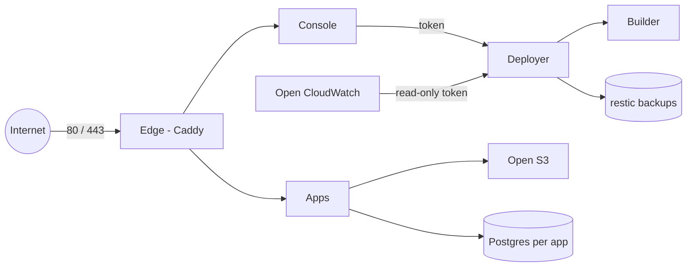

# Architecture

Open Cloud is one Compose project on one machine. The internet only reaches Caddy, on ports 80 and 443. Everything else is on internal networks.

## The deployer

The deployer builds an app from its Dockerfile, starts the container, stops it, and rolls it back to the previous image.

It is the container named `oc-agent` (source in `agent/`). It is the only container with the Docker socket, so it is root-equivalent on the host. It has no published ports. It listens only on the internal `oc_control` network, and only after it checks a generated token. Callers do not send it shell commands. They ask for one of a fixed list of actions (deploy, redeploy, roll back, create a database, write a secret, and so on), and each action checks its inputs before it does anything.

When a build is needed, the deployer hands the Dockerfile to the builder. The builder is a separate rootless BuildKit container (`oc-builder`). It has no Docker socket and no host mounts. It can download packages. It cannot open the deployer's API, because that API is not on the builder's network.

The console never talks to Docker. It calls the deployer.

## The other parts

**Edge** (`oc-edge`, Caddy) is the only container that publishes host ports. It terminates TLS for the console, for every external app, and for every static site. Certificates come from Let's Encrypt, or from Caddy's local CA when `OC_TLS=internal`. Static sites are a read-only directory mount. The edge is Open ELB: routes are small Caddy files the deployer writes, validates, and reloads. A failed reload puts the previous file back.

**Console** (`oc-console`) is the admin UI. It sits on `oc_console`, a network shared only with the edge, so apps cannot reach it. Its filesystem is read-only except for its own login directory. It runs as an unprivileged user.

**Apps** run as `oc-app-<name>-web-1` with capabilities dropped, `no-new-privileges`, memory, CPU, and pid limits, and rotated logs. An app can opt in to a health check, a read-only root filesystem, and `tmpfs` paths in `opencloud.json` or `app.json`. With a health check, a deploy waits until the app is healthy. Internal apps (the default) have no public route. External apps are served at `https://<name>.<apps domain>`.

**Postgres** is one Postgres 17 container per app, on a network marked internal, with no published port. The app connects as `app_runtime` (row changes only). The role `app` stays inside the database container for schema changes.

**Open S3** (`oc-storage`, SeaweedFS) keeps anonymous access off. Each app gets a key limited to its own buckets. Static sites are stored in a private bucket and unpacked into a directory the edge serves.

**Open Bedrock** stores one provider key as a root-owned secret and mounts it only into apps you opt in. The generic gateway (`oc-llm-gateway`) is a separate container and is off unless `OC_GENERIC_GATEWAY=1`.

**Open CloudWatch** (`oc-watch`) polls the deployer with a read-only token. It keeps metrics, redacted logs, and alarms in SQLite. It has no Docker socket.

**Backups** are a deployer action: `pg_dumpall` of every app database, then an encrypted restic snapshot. Nothing in Open Cloud runs that action on a timer.

## Networks

| Network | Who is on it |
|---|---|
| `oc_edge` | Edge, apps, storage, the optional gateway, CloudWatch (the name apps use is `cloudwatch`) |
| `oc_control` | Console, deployer, CloudWatch. Internal. The deployer listens only here |
| `oc_console` | Edge and console. Internal |
| `oc_agent_egress` | Deployer and builder, so image builds can reach the internet |
| `oc-app-<name>` database network | That app and its Postgres. Internal |

Apps on `oc_edge` can reach each other as `app-<name>:<port>`. Internal means there is no public URL.

## Where settings come from

Hostnames, the data directory, allowlists, and feature switches are environment variables in `.env`. `install.sh` reads that file and writes the edge config, secret files, and any extra Compose mounts onto the server. They are not hardcoded in this repository. The example values are in `.env.example`.

## Optional: your own proxy in front

`OC_EDGE_MODE=external` does not start `oc-edge` and does not publish ports. Your proxy joins the console to a Docker network you name with `OC_PROXY_NETWORK`. A site block for that arrangement is `docs/console.caddy.example`. The install guide assumes the built-in edge.

## What is not isolated

A hostile Dockerfile runs in the builder container, not as host root, but the builder's seccomp profile is weaker than Docker's default and the build has internet access. Root on the server can read every secret and rewrite the audit log. See [SECURITY.md](SECURITY.md).
